# NutriFit AI

**NutriFit AI** is a nutrition and home-fitness coach for Android, written in Java with XML views. Snap a photo of
your plate (or say or type what you ate) and get an editable AI estimate; track water, weight, steps, walks and
fasting; train with workouts whose reps are counted by your camera and a voice coach; and stay motivated with
friends through a feed, chats, voice/video calls and live workout challenges.

| | |
|---|---|
| Application ID | `com.transformsai.nutrifitai` |
| Version | 1.2.4 · minSdk 26 (Android 8.0) · target/compile SDK 36 |
| Language / UI | Java 17, XML layouts, Android Views, custom Views |
| Backend | Firebase (Auth, Cloud Firestore, Realtime Database) + a Java 17 server in [`server/`](server) |
| Public server URL | `https://nutrifitai.transformsai.org/` (Cloudflare tunnel → port 8787 on the host machine) |

---

## Contents

1. [Screens](#screens)
2. [Features in detail](#features-in-detail)
3. [How it works](#how-it-works)
4. [Architecture](#architecture)
5. [Data model and sync](#data-model-and-sync)
6. [The server](#the-server)
7. [Security and privacy](#security-and-privacy)
8. [Build, run and install](#build-run-and-install)
9. [Configuration](#configuration)
10. [Testing](#testing)
11. [Project layout](#project-layout)
12. [Android topics covered](#android-topics-covered)
13. [Data sources and licences](#data-sources-and-licences)

---

## Screens

Real screenshots from the app running on a phone and an emulator.

**Getting started**: welcome, sign in, a five-step profile with live BMI, and daily targets that explain their maths.

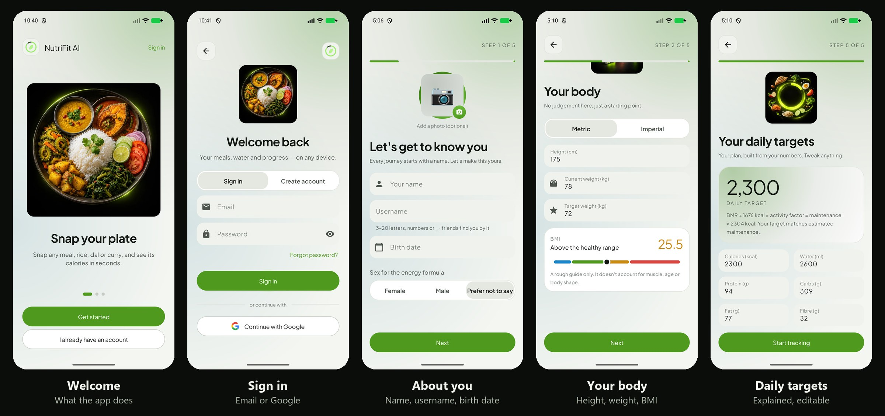

**Nutrition**: the home dashboard in dark and light themes, and progress against your targets.

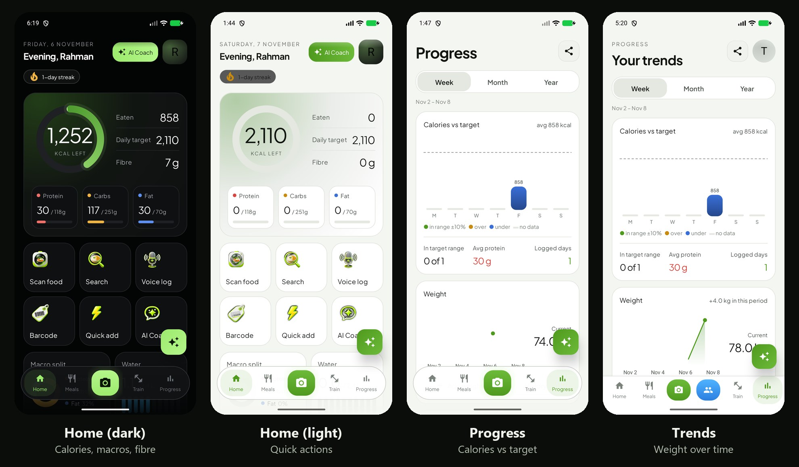

**Training**: schedule, workout plans with muscle maps, a live camera workout counting jumping jacks, and the
shareable workout card.

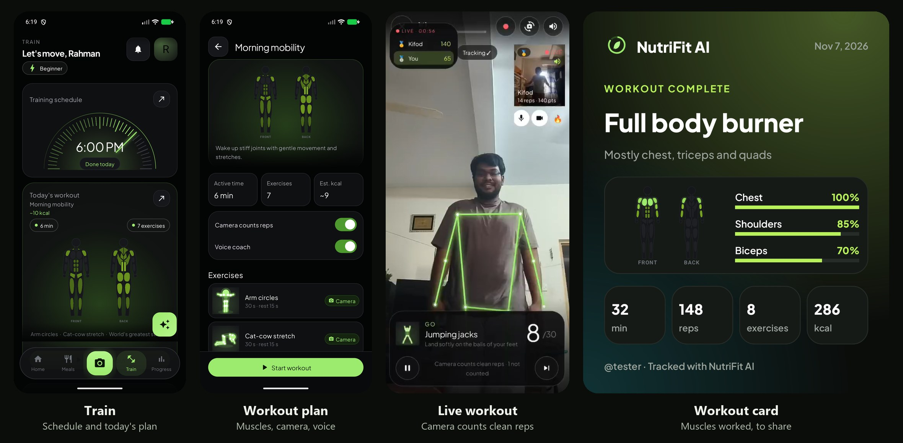

**Social and challenges**: the feed, challenging a friend, the countdown, results and the podium card.

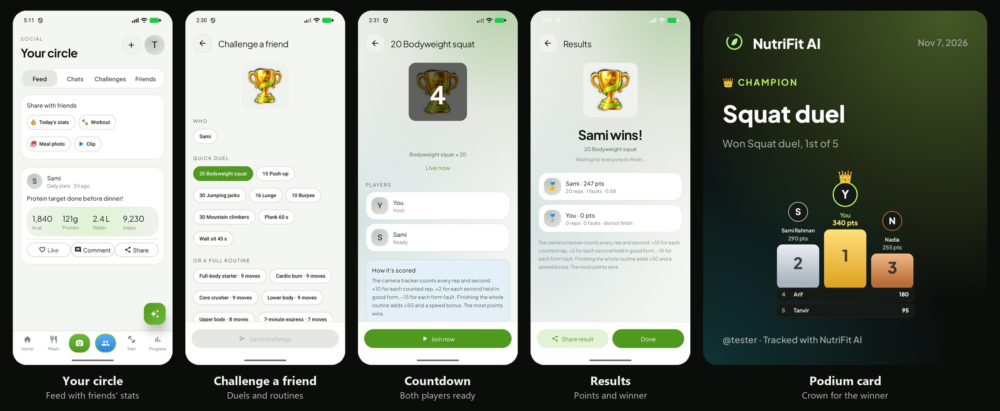

**Chat, calls and profile**

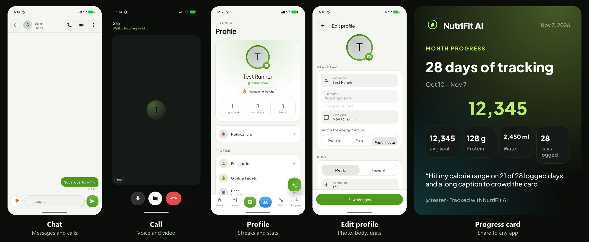

---

## Features in detail

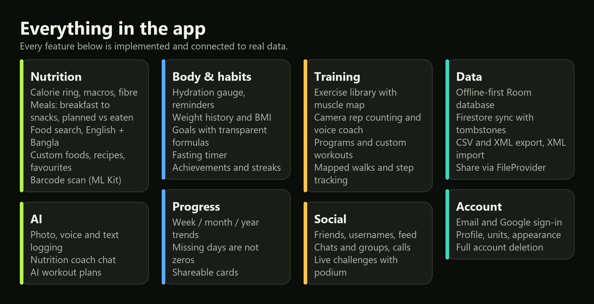

### 1. Account and onboarding
- **Sign in** with email/password or Google (Credential Manager). Password reset by email. Sessions persist.
- **Five-step signup**: name and unique `@username` (checked live), birth date, sex for the energy formula (or
  "prefer not to say"), optional photo; height, current and target weight with a **live BMI bar**; activity level
  and goal (lose, maintain, gain); diet preferences and allergies; metric or imperial units.
- **Permissions step**: notifications, camera, microphone, and activity / Google Fit through Health Connect, each
  explained. Anything declined is asked again in context when a feature needs it; if Android stops showing the
  prompt, the app explains and opens its settings page.
- **Daily targets** from the Mifflin–St Jeor estimate × activity factor, with a moderate adjustment for the
  goal. Every number is shown with its formula and can be edited. Targets are saved as dated
  snapshots, so changing a goal never rewrites past days.
- **Profile**: edit photo, name, username, body data and units; light or dark theme; full **account deletion**
  that removes Firestore data, server files and local data (re-authentication when needed).

### 2. Home dashboard
- Personal greeting and the real date; a **calorie ring** with eaten, daily target and remaining or "over".
- Protein, carbs, fat and fibre totals against targets, with a macro split chart.
- Quick actions: **scan food**, **search**, **voice log**, **barcode**, **quick add**, **AI coach**.
- Water summary with one-tap adds, today's meals, streak, steps and a challenge card.
- Every number comes from saved entries and updates immediately after an add, edit or delete.

### 3. Meal diary
- Breakfast, lunch, dinner and snacks for any date (today, yesterday, tomorrow, or a date picker).
- **Planned** and **eaten** meals are separate; planned meals never count as eaten until you convert them.
- Servings with fractions or grams; add, edit, delete, duplicate, move between meals, copy to another date.
- Favourites and recent foods; meal and day totals; empty states with real actions.

### 4. Food search and personal foods
- **Offline search** in English and Bangla across 70 curated Bangladeshi foods (rice, roti, paratha, dal,
  khichuri, biryani, curries, fish, eggs, vegetables, fruit, milk, yogurt, tea, snacks) and 7,283 USDA foods.
- Every food shows its **source** (curated, USDA, user-entered, AI estimate). Unknown nutrients show as
  "not available", never as zero.
- Food detail: image, serving, editable amount, calories, macros, sugar, sodium and minerals when known, favourite
  and add-to-meal.
- **Custom foods** (per-100 g values and servings), **recipes** whose nutrition is calculated from ingredients,
  and **barcode** scanning with ML Kit for packaged foods.

### 5. AI food logging (photo, voice, text)

- Take a photo with CameraX or pick one; orientation is corrected and the image compressed before upload.
- Add an optional note (portion, oil, hidden ingredients). The AI returns each food with a portion, grams,
  nutrients, confidence, a calorie range and its assumptions.
- **Voice logging** with Android speech recognition (English and Bangla where available) and an editable
  transcript; or type naturally: "two rotis, one egg and a cup of milk".
- Every item is editable. Changing grams or servings rescales all nutrients; values you type become the new
  baseline. Totals are recalculated in the app. **Nothing is saved until you confirm.**
- Handles several foods per plate, uncertain photos (the AI asks a clarifying question), non-food photos, network
  failures, timeouts and malformed replies, each with a clear message and retry.

### 6. Hydration
- Animated water gauge, consumed vs target, quick adds (glass, bottle, custom), edit and delete entries, last
  drink time, daily history and a weekly chart.
- Reminders with interval, active hours and an evening cutoff; restored after reboot and time zone changes.

### 7. Weight, progress and achievements
- Weight history with add, edit and delete; change over the chosen period; BMI.
- Week, month and year charts: calories vs the target that applied on that day, macros, water and weight.
  **Missing days are not counted as zero**: averages use logged days only, and the app never treats eating less
  as automatically better.
- Achievements and streaks; shareable progress cards.

### 8. Training and camera workouts
- Exercise library with a **muscle map** (front and back), instructions and difficulty.
- Programs, saved plans, custom workouts with sets, reps or seconds, and **AI-generated plans** limited to
  exercises the camera can track.
- **Camera rep counting** for 38 moves with MediaPipe pose estimation running on the phone (no video leaves the
  device). A strict form coach counts only clean reps; a **voice coach** speaks counts and tips.
- Workout summary with muscles worked, time, reps and energy, shared as an image card.

### 9. Steps and mapped walks

- Daily steps from the phone's step counter and Google Fit / Health Connect.
- **Mapped walks**: tap GO and the route draws live on a dark OpenStreetMap map with distance, time, pace, speed,
  steps and climb; it keeps recording with the screen off (foreground service). The summary shows the route,
  moving and total time, average pace, average and top speed, climb, energy and per-km splits.
- **No double counting**: see [Steps and walks](#steps-and-walks).

### 10. Fasting timer
Start and end fasts, see elapsed time and history.

### 11. Social
- Friends by `@username`, friend requests, a **feed** of stats, workouts, meal photos and short clips, with
  reactions (👍 ❤️ 😂 😮 💪 🔥) and comments.
- **Chats** and groups (up to 20 people), **voice and video calls** (up to 6 people).
- A notifications inbox with a badge on your profile picture; profile photos everywhere people appear.

### 12. Live challenges

- Challenge friends (up to 8) to a quick duel, a program, a saved plan, or a custom workout you build.
- A lobby where everyone readies up, a countdown, and a live scoreboard while each phone's camera counts reps.
  Friends appear as stick figures or live video, with reactions and voice.
- A results screen and a **podium card with a crown** for the winner.

### 13. AI nutrition coach
- A chat that knows your remaining targets, preferences and restrictions (only what it needs).
- Suggests meals and workouts. Any change to your diary needs your explicit confirmation.
- Stays on nutrition and fitness; never diagnoses or promises a meal is allergen-free.

### 14. Data export and import
- Export your data to **CSV** and versioned **XML** with a foreground service (notification with cancel), saved
  to Downloads and shared with **FileProvider**.
- **Import XML** with validation, a preview, duplicate detection and confirmation.

### 15. Reminders and system events
- Meal and water reminders with AlarmManager; restored by `BootReceiver` and `TimeChangeReceiver`.
- Reacts to airplane mode (offline notice, sync when back), battery saver and low battery (lighter pose model;
  a running walk is stopped and saved). Settings › System events lists what happened and what the app did.
- In landscape, the bottom bar becomes a navigation rail on the left.

---

## How it works

### Food photo analysis

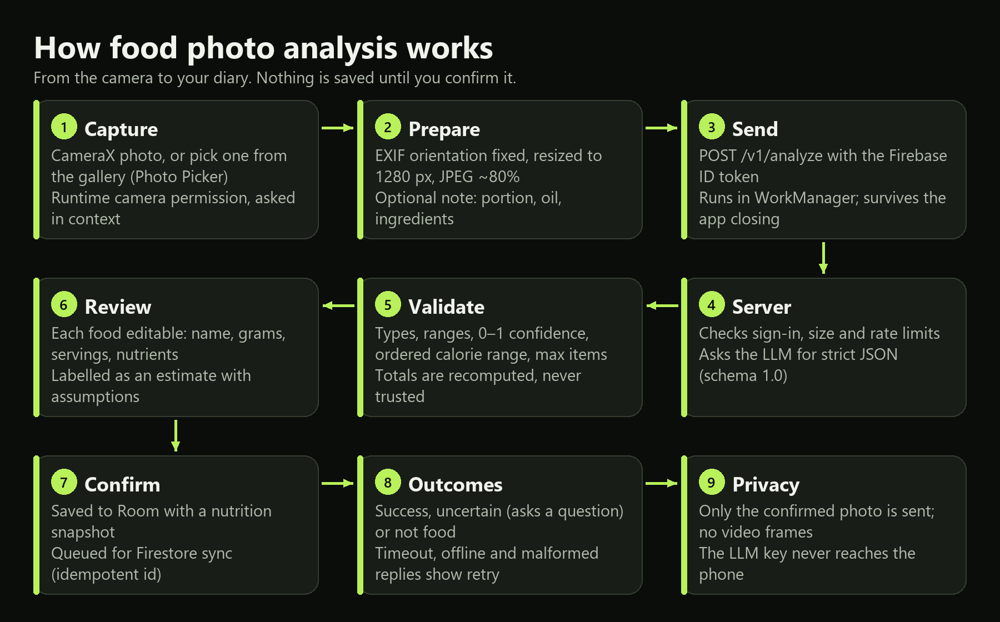

The server asks the LLM for JSON matching schema `1.0`:

```json
{
  "schema_version": "1.0", "status": "success", "input_type": "image", "is_food": true,
  "items": [{
    "name": "Cooked white rice", "name_bn": "সাদা ভাত", "confidence": 0.85,
    "portion": { "quantity": 1, "unit": "bowl", "estimated_weight_g": 200 },
    "nutrition_for_portion": { "calories_kcal": 260, "protein_g": 5.4, "carbohydrates_g": 56.4,
                               "fat_g": 0.6, "fibre_g": 0.8, "sugar_g": null, "sodium_mg": null },
    "calorie_range_kcal": { "min": 220, "max": 310 },
    "source": "ai_estimate", "assumptions": ["Estimated portion size"]
  }],
  "warnings": ["Image-based nutrition estimates may be inaccurate."],
  "clarifying_questions": []
}
```

Both the server and the app (`ai/AiResultParser`) validate it: required fields and version, types, finite
non-negative nutrients, positive portions, confidence 0–1, ordered calorie ranges, bounded item counts and string
lengths, and `null` for unknown nutrients. Totals from the model are ignored and recalculated. A malformed reply
is repaired once; if that fails, you get an actionable error, never invented numbers.

### Live challenges and rep counting

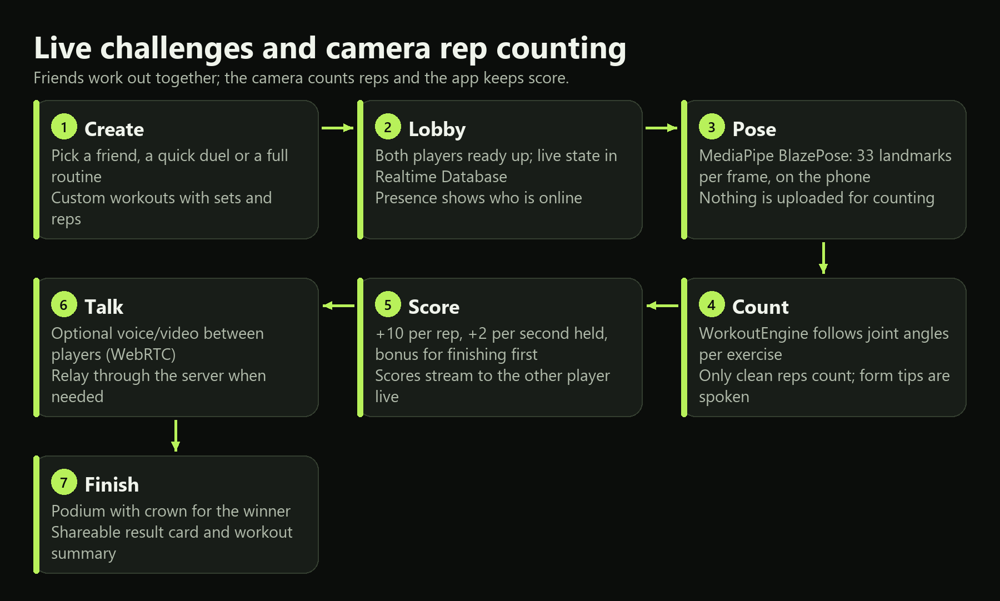

### Calls

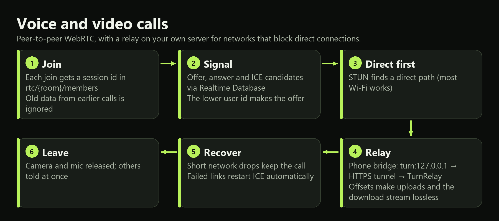

The relay (`server/.../TurnRelay.java`) is a small TURN server built into the Java server. Phones reach it over
HTTPS through the same Cloudflare tunnel as everything else, so it needs no open ports, public IP or paid service.
On the phone, `CallRelayBridge` exposes `turn:127.0.0.1:{port}` to WebRTC and carries its bytes with
`POST /v1/relay/{id}/up` and a streamed `GET /v1/relay/{id}/down`, both with byte offsets so retries never lose or
repeat data. Relay traffic only flows between the server's own allocations, never to outside addresses.

### Steps and walks

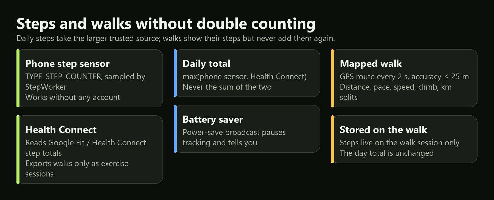

---

## Architecture

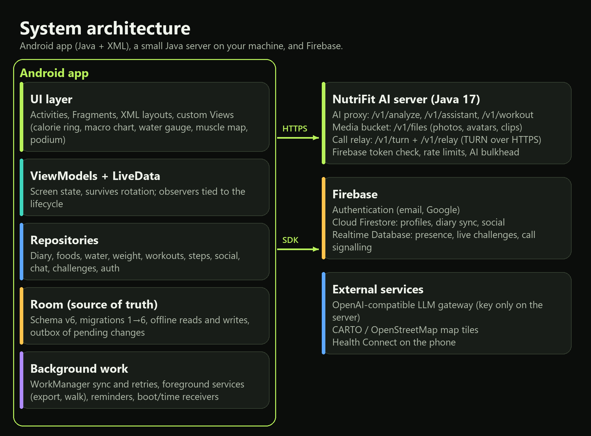

- **UI**: Activities and Fragments with XML layouts and View Binding; custom Views (`ui/widget`) for the calorie
  ring, macro chart, water gauge, muscle map, podium, route art and charts.
- **State**: ViewModels with LiveData; lifecycle-aware observers; saved state for drafts and rotation.
- **Data**: repositories (`data/repo`, `social/`) over Room DAOs, Firestore, Realtime Database and the server API.
- **Background**: WorkManager (sync, AI analysis, steps, inbox), foreground services (walk tracker, export),
  AlarmManager reminders, broadcast receivers for boot, time and power events.
- **Device APIs**: CameraX, MediaPipe Tasks (pose), ML Kit barcode, SpeechRecognizer, TextToSpeech, Health
  Connect, osmdroid maps, WebRTC, Photo Picker, FileProvider and MediaStore.

---

## Data model and sync

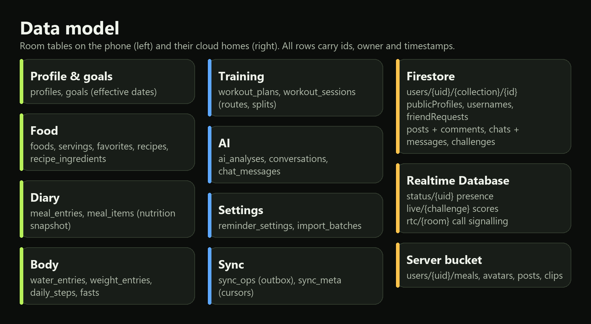

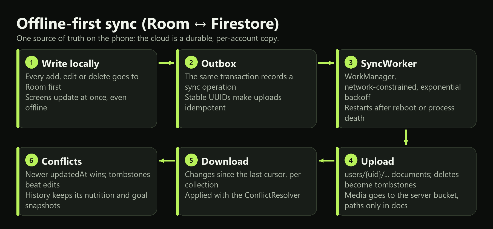

- **One source of truth**: Room on the phone. Firestore is a per-account copy under `users/{uid}/…`.
- **Stable ids** (UUIDs) make every upload idempotent; retries never duplicate a meal or water entry.
- **Deletes** are tombstones, so they reach other devices; **conflicts** resolve by newer `updatedAt`, and a
  tombstone beats an edit.
- **History is preserved**: meal items keep a nutrition snapshot and days keep the goal that applied, so editing a
  food or a goal never changes the past.
- **Migrations**: schema v6 with hand-written migrations 1→6 (exported in `app/schemas`, tested in
  `MigrationTest`). No destructive fallback.
- **Dates**: entries store an instant plus the local date they belong to, so midnight and time zone changes are
  handled correctly.
- **Accounts**: signing out clears local data for that account; another account never sees cached data.

---

## The server

A framework-free Java 17 HTTP server ([`server/`](server)) that keeps every secret off the phone.

| Route | Purpose |
|---|---|
| `GET /healthz` | Status (public) |
| `POST /v1/analyze` | Food photo / text analysis (strict JSON) |
| `POST /v1/assistant` | Nutrition coach chat, scoped to nutrition and fitness |
| `POST /v1/workout` | AI workout plan from a fixed list of trackable exercises |
| `PUT/GET/DELETE /v1/files/users/{uid}/…` | Private media bucket (meal photos, avatars, post photos, clips) |
| `GET /v1/turn` | Call relay login (plus any external TURN servers configured) |
| `/v1/relay/*` | The call relay transport (open, up, down, close) |

- Verifies **Firebase ID tokens** on every call; per-user **rate limits**; size and content checks.
- The LLM key is read from `server/.env` (`NUTRIFIT_LLM_API_KEY`); only the configured upstream is contacted;
  bounded timeouts and one retry; logs contain hashed user ids only.
- Built for many users at once: an elastic thread pool, at most 32 AI requests in flight (others wait, then get
  `503 busy` with `Retry-After`) so slow AI calls never hold up files or calls, and self-pruning caches.

---

## Security and privacy

- Firestore and Realtime Database **rules** restrict private data to its owner (`firebase/`), with 38 emulator
  tests. Shared data (usernames, profiles, posts, chats, challenges) is readable only by the people involved.
- No secrets in the APK: the LLM key lives only on the server; the CARTO map key and signing passwords are in
  git-ignored files.
- Only a photo you confirm is analysed; camera frames for rep counting never leave the phone.
- Nutrition values are estimates, not medical advice.

---

## Build, run and install

Requirements: JDK 17 and Android SDK 36. From the project root:

```bash
./gradlew :app:assembleDebug            # debug APK
./gradlew :app:assembleRelease          # signed release APK (needs keystore.properties)
./gradlew :app:testDebugUnitTest        # JVM unit tests
./gradlew :app:lintDebug
./gradlew -p server test fatJar         # server tests + server/build/libs/nutrifitai-server.jar
```

Install on a phone:

```bash
adb install -r app/build/outputs/apk/release/app-release.apk
```

Run the server (keep it running for AI, media and call relay):

```bash
cp server/.env.example server/.env      # then set NUTRIFIT_LLM_API_KEY
server/start-server.cmd                 # http://127.0.0.1:8787, published through the Cloudflare tunnel
```

---

## Configuration

**Firebase** (`nutrifit-ai-6c41c`)
1. `app/google-services.json` is the config for `com.transformsai.nutrifitai`.
2. Enable Authentication (Email/Password and Google), Cloud Firestore and the Realtime Database.
3. Add the signing SHA-1/SHA-256 fingerprints under Project settings › Your apps (needed for Google sign-in).
4. Deploy rules and indexes:
   `cd firebase && npx firebase deploy --only firestore:rules,firestore:indexes,database --project nutrifit-ai-6c41c`

**Release signing**: `keystore.properties` (git-ignored) in the project root:

```
storeFile=../keystore/nutrifitai-release.jks
storePassword=…
keyAlias=nutrifitai
keyPassword=…
```

**Map tiles**: CARTO basemaps need a key in `local.properties` (git-ignored): `nutrifit.cartoKey=…`.
Raster tiles are available up to zoom 18.

**AI access**: in the default (demo) build AI is open to every signed-in account (`nutrifit.aiOpen=true`, server
`AI_OPEN_TO_ALL=true`). For approval-only access, set both to false and enable people in Firestore
`aiAccess/{uid}.allowed` (or pre-allow an email in `aiAllowList/{email}`).

**Server `.env`**: `NUTRIFIT_LLM_API_KEY`, `FIREBASE_PROJECT_ID`, `PORT`, `HOST`, `UPSTREAM_BASE_URL`,
`UPSTREAM_MODEL`, `AI_OPEN_TO_ALL`, `AI_MAX_CONCURRENT`, `SERVER_THREADS`, and optional external TURN servers
(`CF_TURN_KEY_ID`/`CF_TURN_KEY_API_TOKEN`, or `TURN_URLS` with `TURN_SECRET` or `TURN_USERNAME`/`TURN_CREDENTIAL`).

**Notifications**: while the app is open, new notifications appear at once; in the background WorkManager checks
about every 15 minutes.

---

## Testing

| Suite | What it covers |
|---|---|
| App unit tests (93) | Portions and grams, calorie and macro totals, goal formulas, dates across midnight and time zones, planned vs eaten, AI JSON validation (malformed, non-food, uncertain), sync and duplicate protection, reminders, XML import/export, route tracking, workout engine and form coach, social scoring, relay server lists |
| Instrumented tests | Room CRUD and migrations 1→6, navigation, share-card rendering, map tiles |
| Server tests (35) | Token checks, validation, rate limits, files ownership, AI concurrency limits, TURN credentials, the built-in relay (two phones exchanging data, bad passwords, retries) |
| Rules tests (38) | Firestore and Realtime Database ownership, social sharing, call signalling |

```bash
cd firebase && npm install && npm run test:rules
```

---

## Project layout

```
app/src/main/java/com/transformsai/nutrifitai/
  ai/         AI result models, parser, analysis worker
  call/       WebRTC calls, relay bridge, ICE servers
  data/       Room (db), repositories (repo), server and Firebase clients (remote), food search (rag)
  domain/     nutrition maths, goals, BMI, progress stats, achievements
  fitness/    exercises, workout engine, pose (MediaPipe), voice coach, route tracker
  health/     step sensor, Health Connect, walk service
  io/         CSV/XML export and import, export service
  reminders/  scheduling, notifications, boot/time/system receivers
  social/     friends, feed, chats, challenges, inbox
  sync/       outbox, sync engine, conflict resolver, worker
  ui/         screens and custom views
app/schemas/  exported Room schemas
server/       Java AI proxy, media bucket, call relay
firebase/     Firestore and RTDB rules, indexes, rules tests
docs/         presentation guide, licences, images
```

---

## Android topics covered

| Topic | Where |
|---|---|
| Gradle and project structure | `build.gradle`, `app/build.gradle`, Gradle wrapper, pinned dependency versions |
| AndroidManifest | components, permissions, `exported` flags, FileProvider, foreground service types |
| Activity lifecycle | camera and microphone released in `onPause`/`onDestroy`, `CallSession.leave`, saved state |
| XML layouts, View Binding, events | every screen in `res/layout*`, validated inputs, click handling |
| Explicit and implicit intents | food detail, camera, workout screens; share sheet for cards and exports |
| Responsive layouts | ConstraintLayout, `layout-land` rail, `values-land` dimensions |
| RecyclerView | diary, search results, feed, chats, messages, assistant, history |
| Custom Views | `ui/widget` (calorie ring, macro chart, water gauge, muscle map, podium, route art) |
| Services | `ExportService` and `WalkService` (foreground, notification with cancel/stop) |
| BroadcastReceivers | `BootReceiver`, `TimeChangeReceiver`, `SystemEventsReceiver`, `ReminderReceiver` |
| Content Providers | FileProvider sharing, MediaStore downloads, Photo Picker via ContentResolver |
| Permissions | `ui/common/Permissions` (contextual asks, permanent denial recovery) |
| Networking and JSON | OkHttp to the server; Gson with strict validation (`AiResultParser`) |
| XML parsing | `io/XmlCodec` import with preview and duplicate handling |
| Database | Room entities, DAOs, migrations, queries; Firestore sync |
| Background work | WorkManager workers, AlarmManager reminders |
| Advanced APIs | CameraX, MediaPipe, ML Kit, SpeechRecognizer, TextToSpeech, Health Connect, WebRTC, osmdroid |
| Firebase | Authentication, Cloud Firestore, Realtime Database |

A screen-by-screen demo guide is in [`docs/PRESENTATION_CHECKLIST.md`](docs/PRESENTATION_CHECKLIST.md).

---

## Data sources and licences

- Map data © OpenStreetMap contributors (ODbL), map tiles © CARTO, rendered with osmdroid (Apache-2.0).
- USDA FoodData Central SR Legacy (public domain); free-exercise-db (public domain); Google ML Kit pose samples
  (Apache-2.0); food photos from Wikimedia Commons with credits in `assets/food_images/credits.json`;
  Plus Jakarta Sans (OFL, `docs/licenses`).
- The in-app 3D icons and hero art are AI-generated.
- Nutrition estimates are approximate and not medical advice; the app cannot guarantee a food is allergen-free.
